# charcoal

A terminal ASCII art viewer for images, animations and video, written in C.

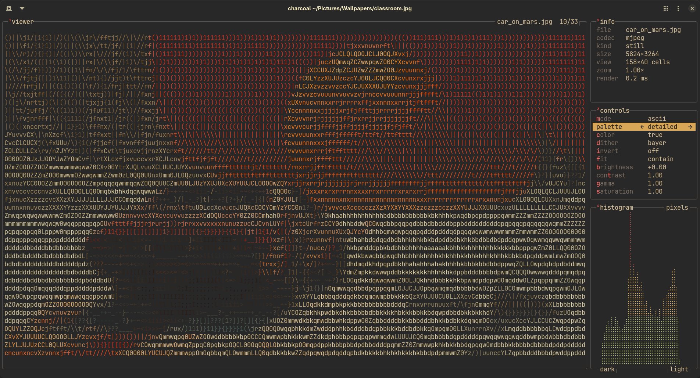

## Features

- Opens almost any image, animated image or video through FFmpeg (PNG, JPEG,
  WebP, AVIF, TIFF, GIF, APNG, MP4, MKV, WebM, ...), photos turned upright
- Five glyph modes, four palettes or your own, true color / 256 / 16 / mono,
  Floyd-Steinberg and Bayer dithering, brightness, contrast, gamma and
  saturation, all changeable live
- A full-screen viewer with panels, a braille histogram, zoom and pan, five
  themes, an options overlay and mouse support
- Smooth video playback with a timeline, seeking and speed control
- Flip through a folder with `n` / `N`, or browse with the file picker
- Scriptable `render` and `export` (`.txt`, `.ans`, `.html`)

Video plays live, and every setting can change while it plays:

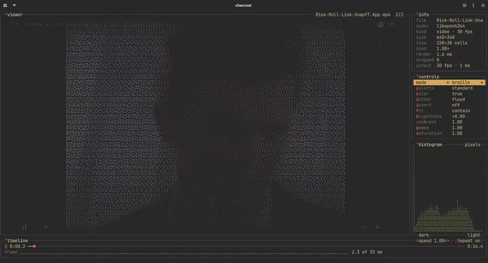

## Install

### Fedora

```bash
sudo dnf copr enable turuu/charcoal
sudo dnf install charcoal
```

Updates come with `dnf upgrade`. Fedora 43 and newer, x86_64 and aarch64
([COPR page](https://copr.fedorainfracloud.org/coprs/turuu/charcoal/)).

### Any Linux, in one line

```bash
curl -fsSL https://raw.githubusercontent.com/Zemosis/charcoal/main/install.sh | sh
```

Works on Debian, Ubuntu, Arch, openSUSE, Alpine and Fedora (macOS with
Homebrew should work but is not tested yet). It installs the build
dependencies it is missing (a C compiler and FFmpeg's libraries, asking for
`sudo`), builds charcoal and puts it in `~/.local/bin` with its man page and
tab completion for bash, zsh and fish.

Options go after `sh -s --`, for example `... | sh -s -- --system` for
`/usr/local`, `--ref v0.1.1` for a release, or `--uninstall`. From a clone,
`./install.sh` builds that clone.

Then:

```bash
charcoal ~/Pictures
```

### By hand

```bash
# Fedora
sudo dnf install gcc make ffmpeg-free-devel libwebp-devel
# Debian / Ubuntu
sudo apt install build-essential pkg-config libavformat-dev libavcodec-dev libavutil-dev libswscale-dev libwebp-dev
# Arch
sudo pacman -S --needed base-devel ffmpeg libwebp
# macOS
brew install pkg-config ffmpeg webp

git clone https://github.com/Zemosis/charcoal && cd charcoal
make install PREFIX=~/.local     # or: make release && sudo make install
```

FFmpeg 4.4 or newer works; libwebp is optional (it adds animated WebP). `make uninstall` with the same
`PREFIX` removes everything. For zsh completion with `PREFIX=~/.local`, add
`fpath=(~/.local/share/zsh/site-functions $fpath)` before `compinit`.

## Usage

```bash
charcoal                                 # pick a file in this folder
charcoal photo.jpg                       # interactive viewer (? for help)
charcoal ~/Pictures                      # browse a folder (n / N, O)
charcoal clip.mp4                        # plays, with a timeline
charcoal render photo.jpg -m ascii       # print once, for scripts and pipes
charcoal render photo.jpg -m braille -d floyd
charcoal render photo.jpg -m quad -c 256 --contrast 1.3
charcoal render photo.jpg -m ascii -p detailed -c mono -w 80 -i   # light terminal
charcoal render clip.mp4 -t 12.5         # the frame at 12.5 s
charcoal render anim.gif --frame 3       # the 4th frame
charcoal export photo.jpg -o photo.html  # .txt, .ans or .html
charcoal photo.jpg --theme nord
```

When stdout is not a terminal, `charcoal <file>` prints once like `render`.

### Keys

| Keys | |
|---|---|
| `↑` `↓` / `j` `k`, `←` `→` / `h` `l` | Pick a control, change it |
| `m` `p` `c` `d` `i` `f` | Mode, palette, color, dither, invert, fit |
| `b` `t` `g` `s` (capitals lower) | Brightness, contrast, gamma, saturation |
| `+` `-`, `Shift`+arrows / `H` `J` `K` `L` | Zoom, pan |
| `n` `N`, `O` | Next / previous file, file picker |
| `Space`, `,` `.`, `[` `]`, `{` `}` | Play, step a frame, seek 5 s, seek 30 s |
| `<` `>`, `R`, `Home` | Speed, repeat, back to the start |
| `e`, `o`, `?`, `Esc`, `q` | Export, options, help, menu, quit |

The mouse works too: the wheel zooms toward the cursor or changes the
control under it, dragging pans or scrubs the timeline, and buttons, tabs
and lists are clickable.

## Modes

<table>
  <tr>
    <td></td>
    <td>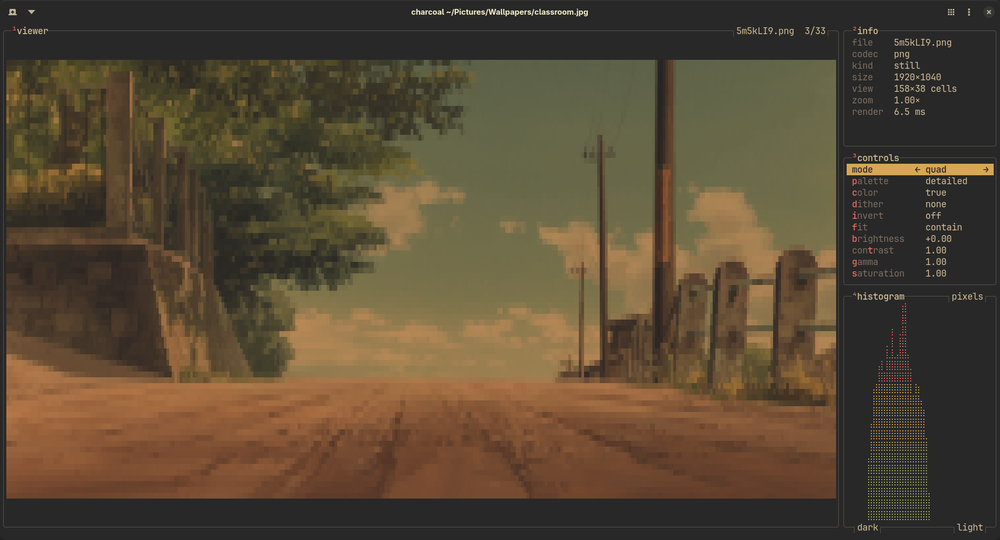</td>
  </tr>
  <tr>
    <td align="center"><code>half</code>: two pixels per cell, the default</td>
    <td align="center"><code>quad</code>: four pixels per cell</td>
  </tr>
  <tr>
    <td></td>
    <td></td>
  </tr>
  <tr>
    <td align="center"><code>braille</code>: eight dots per cell</td>
    <td align="center"><code>edges</code>: lines along edges over ASCII</td>
  </tr>
  <tr>
    <td colspan="2" align="center">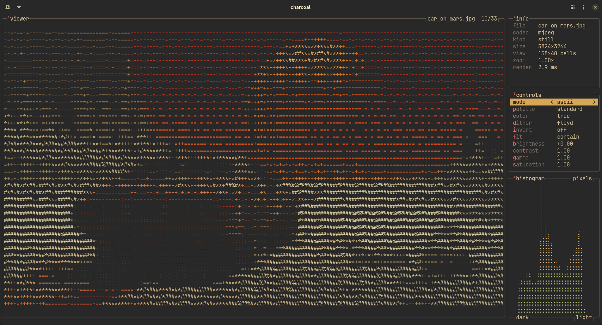</td>
  </tr>
  <tr>
    <td colspan="2" align="center"><code>ascii</code>: one character per cell, by brightness</td>
  </tr>
</table>

## Dithering

<table>
  <tr>
    <td></td>
    <td></td>
    <td>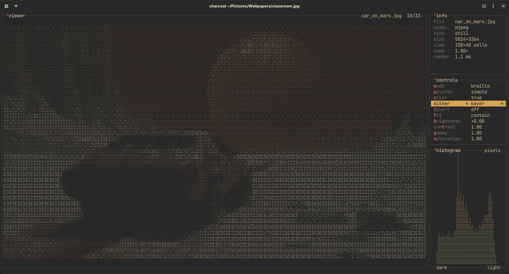</td>
  </tr>
  <tr>
    <td align="center"><code>none</code></td>
    <td align="center"><code>floyd</code>: error diffusion</td>
    <td align="center"><code>bayer</code>: steady in video</td>
  </tr>
</table>

## Palettes

<table>
  <tr>
    <td></td>
    <td></td>
  </tr>
  <tr>
    <td align="center"><code>standard</code> <code>@%#*+=-:. </code></td>
    <td align="center"><code>detailed</code>: 70 levels</td>
  </tr>
  <tr>
    <td>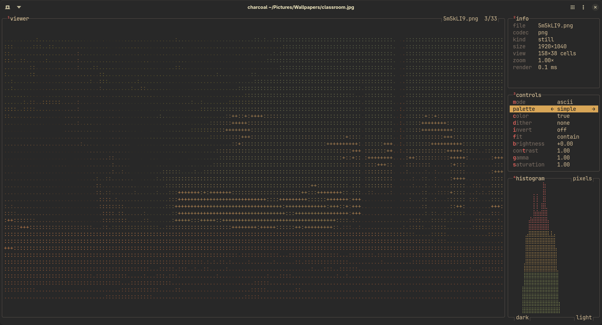</td>
    <td></td>
  </tr>
  <tr>
    <td align="center"><code>simple</code> <code>#*+:. </code></td>
    <td align="center"><code>blocks</code> <code>█▓▒░ </code></td>
  </tr>
</table>

## Color depths

<table>
  <tr>
    <td>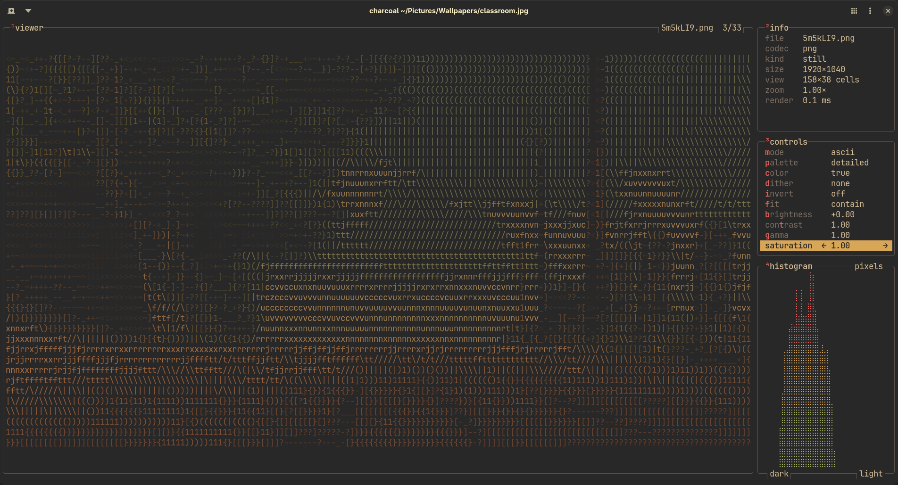</td>
    <td>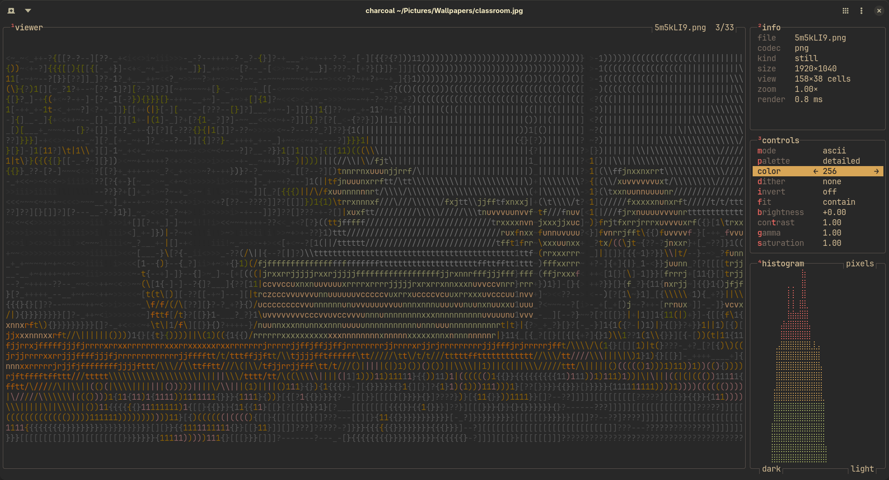</td>
  </tr>
  <tr>
    <td align="center"><code>true</code>: 24-bit</td>
    <td align="center"><code>256</code></td>
  </tr>
  <tr>
    <td>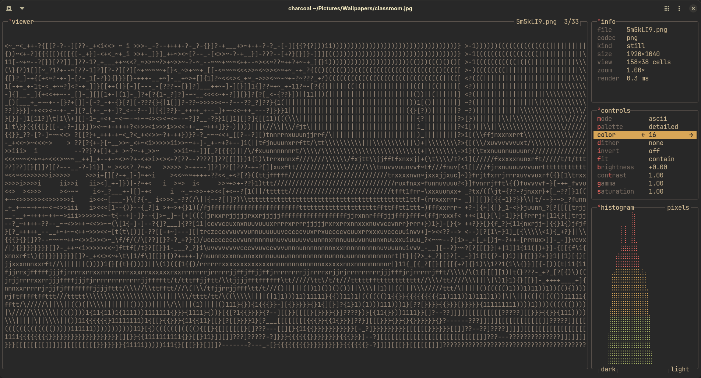</td>
    <td></td>
  </tr>
  <tr>
    <td align="center"><code>16</code></td>
    <td align="center"><code>mono</code></td>
  </tr>
</table>

## Interface

<table>
  <tr>
    <td>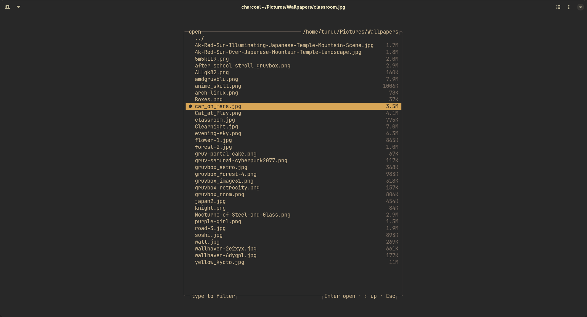</td>
    <td></td>
  </tr>
  <tr>
    <td align="center">File picker (<code>O</code>)</td>
    <td align="center">Options (<code>o</code>)</td>
  </tr>
  <tr>
    <td>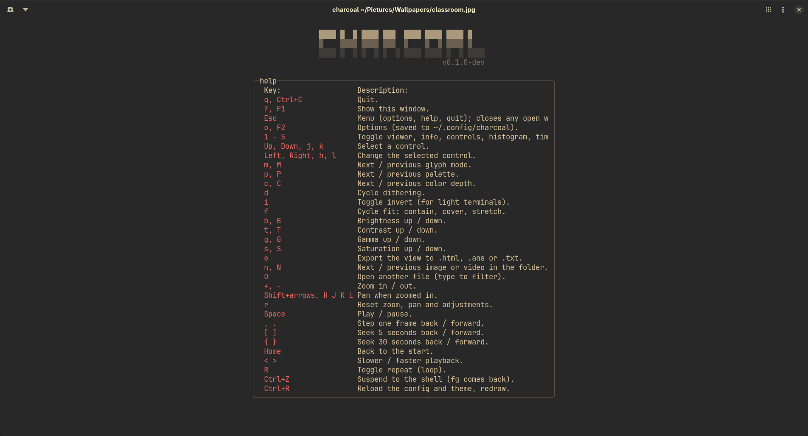</td>
    <td></td>
  </tr>
  <tr>
    <td align="center">Help (<code>?</code>)</td>
    <td align="center">Menu (<code>Esc</code>)</td>
  </tr>
</table>

## Configuration

Press `o` in the viewer for the options; they are saved to
`~/.config/charcoal/charcoal.conf`, as are the panels shown with `1`–`5`
and the folder you last exported to (`e`, then `Ctrl+O` to browse).
Themes: `gruvbox_dark` (default), `nord`,
`tokyo_night`, `mono`, `tty`, or your own
`~/.config/charcoal/themes/<name>.theme` with lines like
`main_bg = "#282828"` (keys: `main_bg`, `main_fg`, `title`, `hi_fg`,
`selected_bg`, `selected_fg`, `inactive_fg`, `box_border`, `graph_low`,
`graph_mid`, `graph_high`).

## Development

```bash
make            # debug build, with ASan and UBSan when installed
make release    # optimized build
make test       # unit tests (no FFmpeg needed)
make golden     # render samples/ and compare with tests/golden/
```

On Fedora, `sudo dnf install libasan libubsan` for the sanitizers.

## License

MIT, see [LICENSE](LICENSE).
